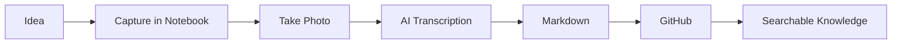

---

# Template
---
title: "Daily Note — YYYY-MM-DD"
date: YYYY-MM-DD
day: Day
week: YYYY-W##
tags:
  - daily-note
  - log
---

# YYYY-MM-DD — Day

> **Daily Focus:**  
> What is the most important thing I want to accomplish today?

---

## 📅 Schedule

| Time | Meeting / Activity | Location / Link | Preparation |
|---|---|---|---|
| 8:00 AM | | | |
| 9:00 AM | | | |
| 10:00 AM | | | |
| 11:00 AM | | | |
| 12:00 PM | Lunch | | |
| 1:00 PM | | | |
| 2:00 PM | | | |
| 3:00 PM | | | |
| 4:00 PM | | | |

### Today's Top Three

- [ ] 
- [ ] 
- [ ] 

---

# ✅ Action Items

## Today

- [ ] **High:** 
- [ ] **Medium:** 
- [ ] **Low:** 

## Waiting For

- [ ] **Person:** Item — Follow up: YYYY-MM-DD

## Future / Backlog

- [ ] 

---

# 🗣️ Meeting Notes

## Meeting: Meeting Name

**Time:**  
**Project:** `PRJ:`  
**Purpose:**  
**Participants:**  
**Reference:**  

### Preparation

- 
- 

### Discussion

- `N:` Note
- `F:` Confirmed fact
- `OBS:` Observation
- `ASM:` Assumption
- `Q:` Question

### Decisions

- `DEC:` Decision

### Actions

- [ ] `ACT:` Action — **Owner:** Name — **Due:** YYYY-MM-DD
- [ ] `ACT:` Action — **Owner:** Name — **Due:** YYYY-MM-DD

### Follow-Up

- `NEXT:` 

---

# 🔧 Engineering / Project Notes

## Project: Project Name

**Project:** `PRJ: ProjectName`

- `N:` General note
- `F:` Confirmed fact
- `OBS:` Observation
- `ASM:` Assumption
- `RISK:` Potential risk or failure mode
- `ISS:` Issue requiring resolution
- `DEC:` Decision and reasoning
- `Q:` Open question
- `REF:` File, email, drawing, or source
- `ACT:` Required action

---

# 💡 Interesting Ideas

## Idea: Short Descriptive Name

**Idea**

`IDEA:` 

**Why is it interesting?**

- 

**Possible Application**

- 

**Related Project**

`PRJ:` 

**Next Experiment**

- [ ] 

---

# 🧠 Facts & Things Learned

| Topic | Fact / Learning | Source | Related Project |
|---|---|---|---|
| | | | |
| | | | |
| | | | |

### Quick Facts

- `F:` 
- `F:` 
- `N:` 

---

# 📊 Diagrams / Mermaid

**Diagram:** `DIAG:`

Use this area to capture processes, relationships, engineering logic, or decision paths.

### Diagram Notes

- `N:` 
- `Q:` 
- `ACT:` 

---

# 🏃 Exercise & Health

## Exercise

| Time | Activity | Duration | Distance / Reps | Avg HR | Intensity | Notes |
|---|---|---:|---:|---:|---|---|
| | Walking | | | | | |
| | Strength | | | | | |
| | Tai Chi | | | | | |
| | Other | | | | | |

## Health

| Measurement | Value | Notes |
|---|---:|---|
| Weight | | |
| Blood Pressure | / | |
| Resting Heart Rate | | |
| Sleep | hrs | |
| Steps | | |

---

# 📈 Stocks

## Stock Watch

| Ticker | Price | Change | 7-Day Avg | 11-Day Avg | RSI | Observation | Action |
|---|---:|---:|---:|---:|---:|---|---|
| | | | | | | | |
| | | | | | | | |
| | | | | | | | |
| | | | | | | | |

## Market Notes

- `MKT:` Market observation
- `STK:` Ticker — Stock observation
- `THESIS:` Ticker — Thesis update
- `RISK:` Ticker — Risk
- `CAT:` Ticker — Potential catalyst
- `ACT:` Ticker — Research or portfolio action

---

# 📚 Reading & References

| Title / Source | Topic | Key Point | Follow-Up |
|---|---|---|---|
| | | | |
| | | | |

## Links

- [Reference](URL)
- [Reference](URL)

---

# 📥 Capture Inbox

Anything interesting that doesn't have a home yet goes here.

- `CAP:` 
- `CAP:` 
- `CAP:` 

Sort these later into projects, facts, ideas, actions, or references.

---

# 🌙 End-of-Day Review

## Completed

- [x] 

## Carry Forward

- [ ] Item → `YYYY-MM-DD`

## Decisions Made

- `DEC:` 

## Most Interesting Thing I Learned Today

- 

## Unresolved Questions

- `Q:` 

## Tomorrow's First Action

- [ ] 

## Daily Summary

> Write two or three sentences summarizing the important parts of the day.

---

# 🔗 Related Notes

- Previous Day:
- Next Day:
- Related Project:
- Related Meeting:
- Related Reference:
